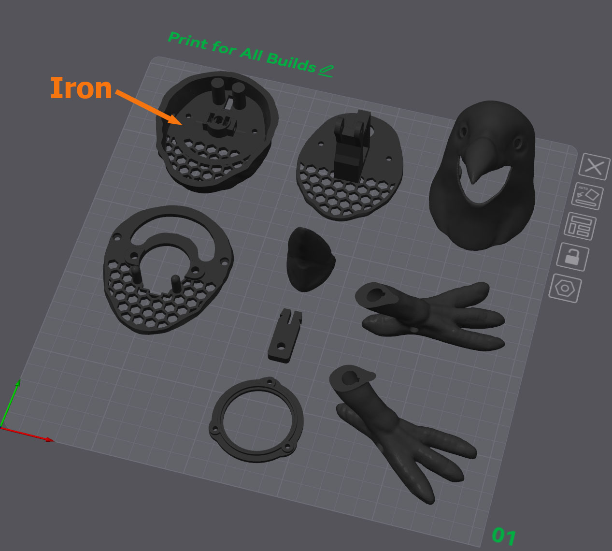
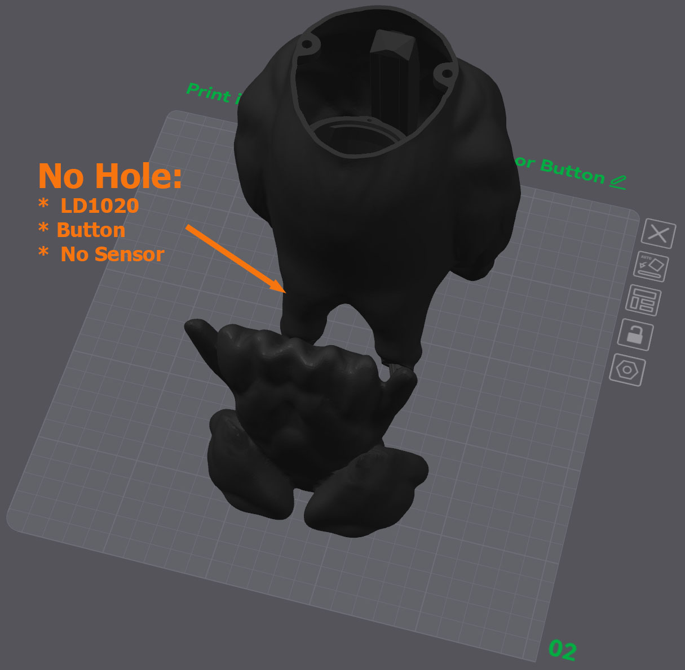
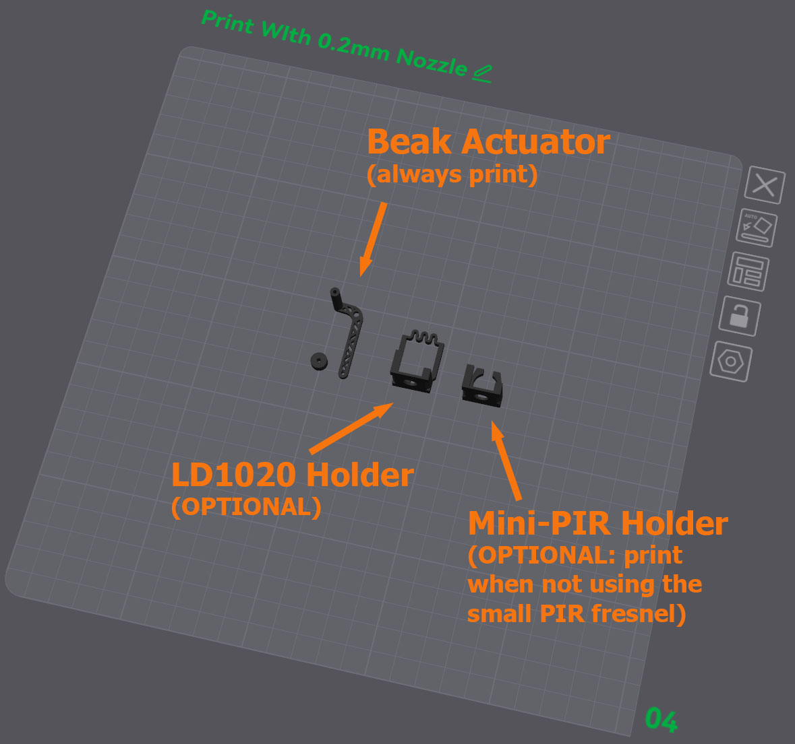

# The 3D model

The printable parts for Raven's body, in the orientation to print them. These are
from Ken Goudey's (swaziloo) [Animatronic Crow](https://github.com/swaziloo/halloween),
minus the parts for the original's circuit board and motion sensors, which Wraven
doesn't use. Assembly: [../docs/assembly.md](../docs/assembly.md).

| File | Part |
|---|---|
| `Head.stl`, `Beak.stl` | The head and the hinged lower beak |
| `HeadServoBeakMountPlate.stl` | Holds the beak servo inside the head |
| `HeadStepperCollar.stl` | Joins the head to the neck stepper |
| `Actuator.stl`, `ActuatorSpacer.stl` | Link the servo arm to the beak (print with a 0.2mm nozzle) |
| `Body.stl` | The body, with the speaker box |
| `BodyStepperPlate.stl` | Holds the neck stepper in the body |
| `BodySpeakerFlange.stl` | Holds the speaker in place (optional; it can be glued) |
| `Tail.stl`, `TailAttachmentTab.stl` | The tail, held on by magnets; the tab screws it to the body (optional) |
| `Feet.stl` or `FeetWithoutHole.stl` | Feet, with or without a tie-down hole |

## Printing

Print in the orientations shown below. PETG is more weather-resistant, but the model
isn't fully weatherproof. PETG with a 0.4mm nozzle at 0.16mm layers gives a strong
build and a shiny, feather-like finish, at the cost of a long print.

The body needs only minimal supports (just for the "ankles"). Supporting the sloping
underside of the beak is worthwhile. The original author's
[.3mf on MakerWorld](https://makerworld.com/en/models/1869791-animatronic-halloween-crow)
includes these settings.

The stepper collar slides against the stepper plate: print the collar with ironing on
to smooth the surface, then sand both the dome mounts on the body plate and the sliding
surface on the collar to 800 grit, and add dry lube to both before assembly.

| | |
|---|---|
|  | Print all the parts on the first plate. Turn on ironing for the top of the collar. Mind the seam on the lower part of the head (aligning it down the middle looks best). The speaker ring and tail screw tab are optional, but recommended. |
|  | The body. |
|  | The actuator and spacer are best printed with a 0.2mm nozzle and a "strength" setting (0.10mm layers). |

## Credits

The model is a remix of the [Animatronic Halloween Crow by andymcculloch](https://www.thingiverse.com/thing:6278223)
and the [Animatronic Halloween Crow by Doctor_JohnSmith](https://www.thingiverse.com/thing:6258153),
which are themselves remixes from [danman](https://www.thingiverse.com/danman/designs), who
remixed the original model by [YahooJAPAN](https://www.thingiverse.com/yahoojapan/designs).
Ken Goudey's changes to each part, from the original project:

| Model                    | Source           | Modifications                                                                                                                                                                                                                                                                                                                                                                                                                                                                                                                                                      |
|--------------------------|------------------|--------------------------------------------------------------------------------------------------------------------------------------------------------------------------------------------------------------------------------------------------------------------------------------------------------------------------------------------------------------------------------------------------------------------------------------------------------------------------------------------------------------------------------------------------------------------|
| Global                   |                  | Standardized on M3 x 4 (or 5) x 5 heat set inserts and M3 fasteners.                                                                                                                                                                                                                                                                                                                                                                                                                                                                                               |
| Head                     | andymcculloch    | Refined beak shape to add more of a point. Smoothed/bevelled lower beak opening. Cut away mounts and rebuilt them slightly wider and short enough to fit below the SG90 servo.                                                                                                                                                                                                                                                                                                                                                                                     |
| Beak                     | Doctor_Johnsmith | Added a lower collar that fits inside the head without a visible cut-away. Re-drew mounting rail and added separate pin mount holes for actuator. Sliced to enable 3D printing standing up.                                                                                                                                                                                                                                                                                                                                                                        |
| Beak Servo Mount Plate   | andymcculloch    | Refined connector tower to accommodate the larger beak when fully open. Straightened out SG-90 mount and shrunk mounting holes to match the screws that come with SG90 servos. Added hexagonal grille for sound. Moved M3 screw holes and shrunk wire pass-thru.                                                                                                                                                                                                                                                                                                   |
| Head Stepper Collar      | andymcculloch    | Moved stepper center. Shrunk cable opening and added alignment pins. Added hexagonal grille for sound with slide path for head pivot pins. Moved M3 screw holes.                                                                                                                                                                                                                                                                                                                                                                                                   |
| Body Stepper Mount Plate | Andymcculloch    | Moved stepper center. Added arched cutout for alignment pins. Added head pivot pins. Added hexagonal grille for sound. Enlarged head holes to accommodate M3 screws.                                                                                                                                                                                                                                                                                                                                                                                               |
| Body                     | Doctor_Johnsmith | Cut away servo mount plate and added mounts for andymcculloch stepper mount plate. Added enclosed box for 40mm speaker with flange. Added internal wire management ring. Added access hole behind left leg. Added mount rail for Creature Control 5x12 PCB. Added internal sensor mount. Added PIR window to right knee (optional). Refined 10x3mm magnet mounts. Added mount and M3 hole for securing tail. Added alignment tabs and reversed pins for feet. Filled legs and added drainage routes around/through speaker out out the low point in the right leg. |
| Feet                     | Doctor_Johnsmith | Reversed pins (socket on feet) and added alignment tabs. Added tie-down horizontal hole through feet.                                                                                                                                                                                                                                                                                                                                                                                                                                                              |
| Tail                     | Doctor_Johnsmith | Refined 10x3mm magnet mounts. Added snap-in tab mount for securing tail to body (optional). Enlarged hole for exterior connection. Made wing tips pointier.                                                                                                                                                                                                                                                                                                                                                                                                        |
